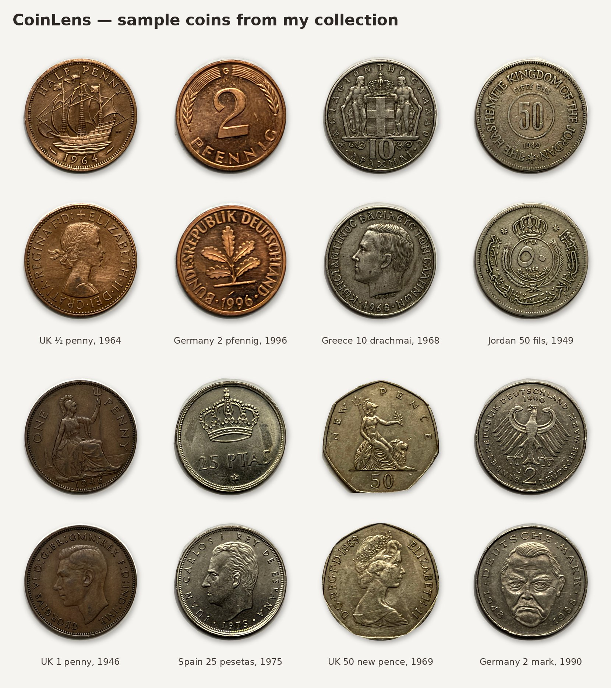
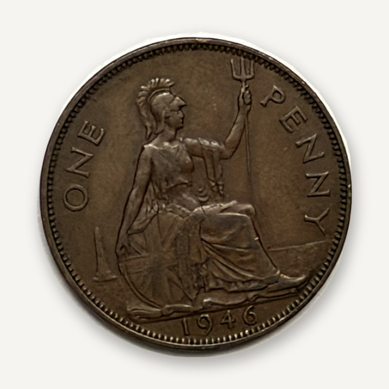
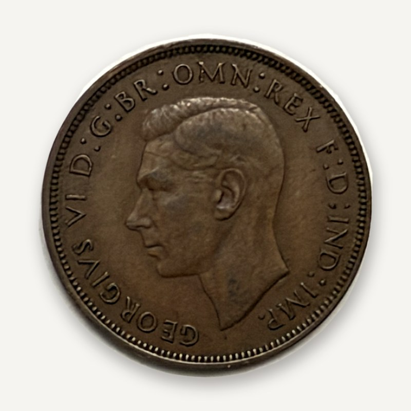

# CoinSorter AI

Building AI course project

## Summary

CoinSorter AI identifies coins from a photo: country, denomination, year and an estimated collector value. It helps people with a jar of mixed foreign coins find out in minutes whether anything is worth keeping – instead of spending days with catalogues.



## Background

Many households have a jar or box of leftover coins from travels, relatives or old collections. Sorting them is slow and frustrating:

* coins come from dozens of countries, many with unfamiliar alphabets (Greek, Cyrillic, Arabic)
* some countries no longer exist (Yugoslavia, USSR, East Germany), so their coins are hard to look up
* it is difficult to tell a common 1-cent coin from a rare year or a valuable silver issue
* most people give up and either throw coins away or sell the whole lot for its weight, losing the few valuable pieces

My personal motivation: I have about 7 kg of mixed world coins (UK, Germany, Greece, Venezuela, Yugoslavia, Poland and more) and I am sorting them by hand to see if anything is valuable. Doing this manually showed me how much of the work is repetitive pattern recognition – a perfect task for AI.

## How is it used?

1. The user lays out a few coins on a plain background and takes a photo with a phone (both sides, if possible).

    

   *Example input: both sides of a UK 1 penny, 1946. The app should return "United Kingdom · 1 penny · 1946 · bronze".*

2. The app detects each coin in the photo and crops it.
3. For each coin, the app suggests the most likely matches: country, denomination, year range and metal.
4. The user confirms or corrects the match with one tap. Corrections are saved and improve the model.
5. The app flags coins that might be valuable (silver content, rare years, errors) and shows an estimated price range.
6. At the end, the user gets a list of their collection that can be exported as a spreadsheet.

Users: hobby collectors, people who inherited a coin collection, flea-market sellers and small coin shops. The app must work offline in basic mode, be simple enough for older users, and clearly show how confident it is about each match.

A simple demo of the matching idea is below. In the real project the features would come from an image model, but here we use measurements (diameter, weight, colour) and a nearest-neighbour search:

```
import math

# Reference coins: (name, diameter_mm, weight_g, colour)
# colour: 0 = copper, 1 = silver-coloured, 2 = gold/brass-coloured, 3 = bimetal
reference = [
    ("UK 1 penny",      20.3,  3.56, 0),
    ("UK 2 pence",      25.9,  7.12, 0),
    ("UK 10 pence",     24.5,  6.50, 1),
    ("Euro 1 cent",     16.25, 2.30, 0),
    ("Euro 10 cent",    19.75, 4.10, 2),
    ("Euro 2 euro",     25.75, 8.50, 3),
    ("Poland 1 zloty",  23.0,  5.00, 1),
    ("Norway 1 krone",  21.0,  4.35, 1),
]

def distance(a, b):
    size_and_weight = math.sqrt((a[0] - b[0]) ** 2 + ((a[1] - b[1]) / 0.5) ** 2)
    colour_penalty = 0 if a[2] == b[2] else 10
    return size_and_weight + colour_penalty

def identify(diameter, weight, colour, k=3):
    measured = (diameter, weight, colour)
    ranked = sorted(reference, key=lambda coin: distance(measured, coin[1:]))
    return [coin[0] for coin in ranked[:k]]

# An unknown copper coin, 20.5 mm and 3.6 g
print(identify(20.5, 3.6, 0))   # -> ['UK 1 penny', 'Euro 1 cent', 'UK 2 pence']
```

## Data sources and AI methods

| Data | Source | Use |
| ----------- | ----------- | ----------- |
| Coin catalogue (country, denomination, years, size, weight, metal) | [Numista](https://en.numista.com/) catalogue and API, used under its terms | Labels and reference data |
| Coin catalogue with mintages and collector price guides | [uCoin](https://ru.ucoin.net/catalog) catalogue, used under its terms | Cross-checking matches, rarity and value hints |
| Coin photos | User-contributed photos with permission; my own collection | Training and testing the image model |
| Prices | Public auction results and dealer price lists | Value estimates |

AI methods:

* **Object detection** to find and crop individual coins in a photo
* **Image classification** (a convolutional neural network, fine-tuned from a pretrained model) to recognise country and denomination
* **Text recognition (OCR)** to read years and inscriptions
* **Nearest-neighbour search** to compare a coin with the most similar catalogue entries, as in the demo above
* **Active learning**: user corrections are added to the training data

## Challenges

* Worn, dirty or damaged coins are hard to recognise, and lighting strongly affects photos.
* Many coins look almost identical across years; the exact year and mint mark often decide the value.
* The app cannot detect fakes or judge condition (grade) reliably – a professional is still needed for valuable coins.
* Price estimates are rough and change over time; the app must not present them as exact offers.
* Copyright: catalogue photos belong to their authors and can only be used with permission.
* There is a risk of misleading users into selling valuable coins too cheaply if the model is wrong, so confidence levels must always be shown.

## What next?

* Start with a small prototype for the most common European coins (euro, British pound, Scandinavian krone).
* Add a "valuable or not" quick filter before full identification – the most useful feature for people with large jars of coins.
* Cooperate with collector communities and numismatic clubs to collect labelled photos.
* Skills needed: computer vision, mobile app development and help from experienced numismatists.

## Acknowledgments

* Inspired by sorting my own jar of mixed world coins
* All coin photos are my own, taken from my collection (backgrounds removed and colours corrected)
* [Numista](https://en.numista.com/) – the collaborative coin catalogue, as a reference and potential data source
* [uCoin](https://ru.ucoin.net/catalog) – coin catalogue with mintage figures and price guides, as a reference
* Building AI course by Reaktor Innovations and the University of Helsinki
* Coin measurements in the demo are approximate public specifications, for illustration only
